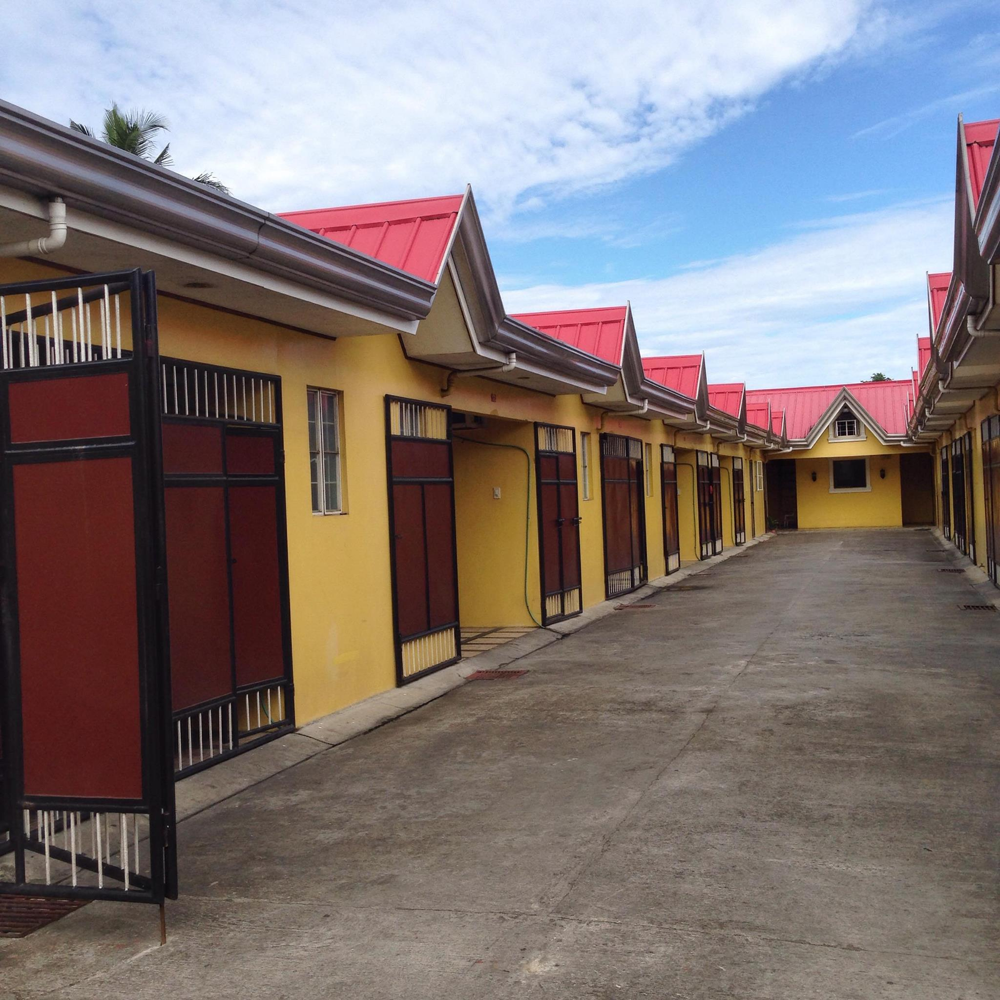
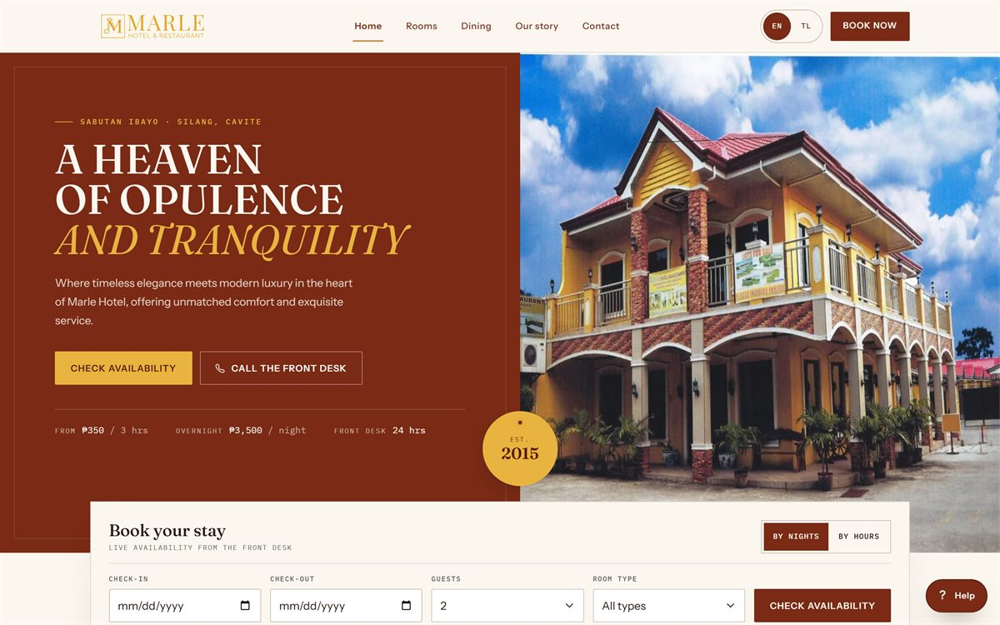
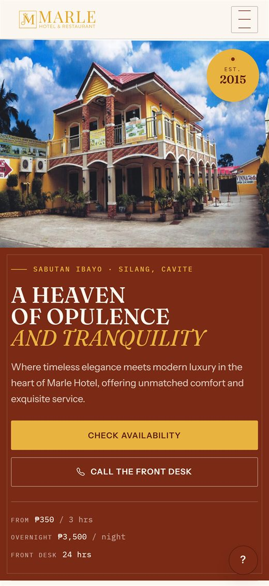
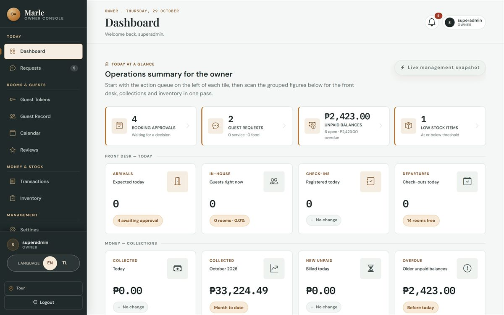
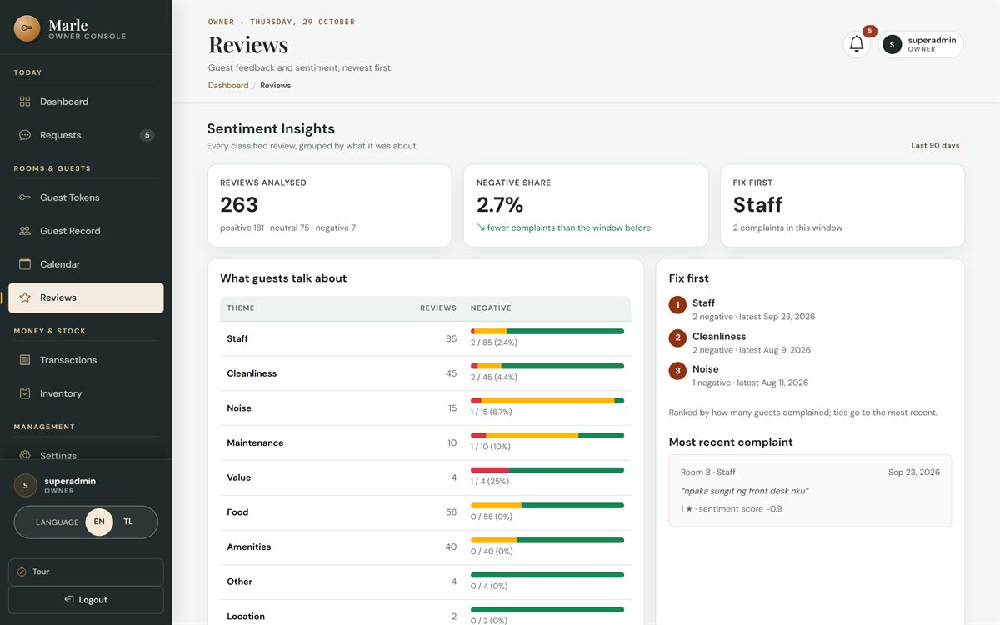
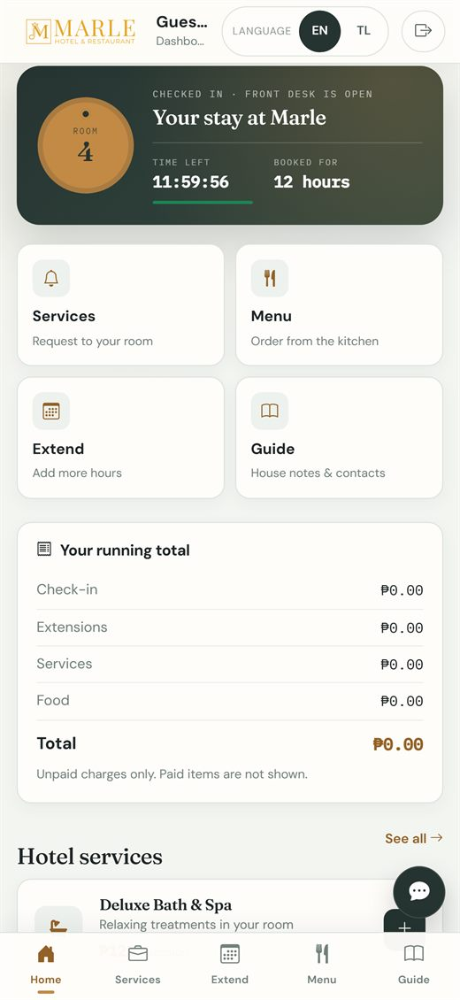

# Marle Hotel & Restaurant — Hotel Management System

A complete hotel operations system in plain **PHP 8 + MySQL**: a public booking website, a guest portal, and a role-based staff console — no framework, no Composer, no build step, deployable on ordinary shared hosting.



## Overview

Marle Hotel & Restaurant is a small hotel in Sabutan Ibayo, Silang, Cavite, Philippines. This repository is the management system built for it: guests book a room by the night or by the hour, pay a 50 % deposit, and manage their stay from a phone; the front desk, the managers and the owner run the same bookings from one console with three separate sets of permissions.

The project was built as an undergraduate capstone and is published here for portfolio and academic review.

## Screenshots

| Public website | The same page on a phone |
|---|---|
|  |  |

| Staff dashboard (owner console) | Sentiment insights — Marle AI |
|---|---|
|  |  |

The guest portal, on a phone — stay countdown, services, menu, extension and the running bill:



> Screenshots show the app's aggregate figures only; guest names, contact details and booking tokens are not included.

## Features

### Public website (`homepage/`)

- Nightly and hourly rates with **live availability** per room and per room type
- Booking form with 11-digit PH mobile validation, MX-checked email address, add-ons, and a required agreement gate
- Deposit flow: GCash / bank transfer with proof-of-payment upload, verified by a manager before the room is confirmed
- Private booking-status page keyed by a **status token** (no account needed), plus guest-initiated cancellation
- Reviews per category, contact page, dining menu, English/Tagalog switch, responsive layout

### Guest portal (`portal/`)

- Sign-in with the booking's status token, behind a data-privacy consent gate
- Live chat with the front desk (with attachments), food orders, service requests, stay extension requests, bill summary
- Review submission, hotel guide and menu, dark mode, offline page + service worker
- Auto-archiving of finished stays and cleanup of stale chats

### Staff console (`admin/`, `employee/`, `superadmin/`)

| Role | Folder | What they can do |
|---|---|---|
| **Manager** | `admin/` | Approve / deny bookings, verify deposits (with proof viewer), amend and cancel stays, record cash walk-ins from the calendar, transactions and collections, inventory, reviews, room board, guest chat |
| **Front Desk** | `employee/` | Calendar, requests inbox, guest tokens, chat, inventory quantities, room status — cannot verify deposits or record cash walk-ins |
| **Owner** | `superadmin/` | Everything above plus settings, activity log, database backup, email diagnostics and repair tools |

Shared by all three: dashboard KPIs and trends, booking calendar, no-show/auto-checkout handling, archive, printable receipts, guest reviews with **AI sentiment analysis** (optional Groq integration) that produces a themed report and action plan.

## Tech stack

- **PHP 8.0+** — procedural, `mysqli` with prepared statements
- **MySQL 5.7+ / MariaDB 10.4+** — 32 tables, `utf8mb4`
- **Bootstrap 5.3**, Bootstrap Icons, Font Awesome, LineIcons, Google Fonts (CDN)
- Vanilla JavaScript — no bundler, no npm, no Composer
- Apache with `mod_rewrite` / `mod_headers` (`.htaccess` included) or equivalent Nginx rules

## Requirements

- PHP 8.0 or newer with `mysqli`, `curl`, `mbstring`, `json`
- MySQL 5.7+ or MariaDB 10.4+
- Apache (XAMPP, Laragon, or any LAMP host)

## Getting started

1. **Put the project in your web root** — e.g. `C:\xampp\htdocs\MarleHotel`.
2. **Create a database** named `marlehoteldb` with collation `utf8mb4_general_ci`.
3. **Import the schema, then the demo data** (in this order, in phpMyAdmin → Import):

   | File | Contents |
   |---|---|
   | `database/schema.sql` | All 32 tables, indexes and keys — structure only, no guest data |
   | `database/seed_demo.sql` | Rooms, amenities, packages, site options and three demo staff accounts |

4. **Set your credentials in `config.php`** — the only file you should need to edit:

   ```php
   if (!defined('MARLE_DB_HOST')) define('MARLE_DB_HOST', getenv('MARLE_DB_HOST') ?: 'localhost');
   if (!defined('MARLE_DB_USER')) define('MARLE_DB_USER', getenv('MARLE_DB_USER') ?: 'root');
   if (!defined('MARLE_DB_PASS')) define('MARLE_DB_PASS', getenv('MARLE_DB_PASS') !== false ? getenv('MARLE_DB_PASS') : '');
   if (!defined('MARLE_DB_NAME')) define('MARLE_DB_NAME', getenv('MARLE_DB_NAME') ?: 'marlehoteldb');
   ```

5. **Open** `http://localhost/MarleHotel/` for the public site, and `http://localhost/MarleHotel/login.php` for the staff console.

### Demo accounts

| Username | Password | Role |
|---|---|---|
| `admin` | `Marle@2026` | Manager |
| `emp` | `Marle@2026` | Front Desk |
| `superadmin` | `Marle@2026` | Owner |

> These are seed accounts for local use. Change or delete them before exposing the app to the internet.

> The email address, phone number and GCash number in the demo data (`frontdesk@marlehotel.example`, `0917 000 0000`) are placeholders — replace them with the hotel's real details before going live.

## Configuration

Everything optional degrades gracefully: leave a value empty and the feature simply stays off.

| Setting | Env var | `config.php` constant | Purpose |
|---|---|---|---|
| Database | `MARLE_DB_*` | `MARLE_DB_HOST/USER/PASS/NAME` | Connection |
| Email provider | `MARLE_EMAIL_PROVIDER` | same | `brevo`, `resend`, `mailgun` — sent over HTTPS API, so no `mail()` needed |
| Email key / sender | `MARLE_EMAIL_API_KEY`, `MARLE_EMAIL_FROM` | same | Verified sender with the provider |
| Staff alerts inbox | `MARLE_EMAIL_NOTIFY_TO` | same | Receives new-booking and cancellation alerts |
| AI sentiment | `GROQ_API_KEY` | same | Enables guest-review sentiment analysis |
| Cron secret | `MARLE_CRON_SECRET` | same | Lets an external scheduler call `admin/cron_archive.php?key=…` |
| Site root | `MARLE_BASE_URL` | same | Absolute URL used in outgoing email links |

Environment variables take priority; the constants are the fallback for shared hosts without settable env vars. **No keys are committed to this repository.**

## Project structure

```
.
├── index.php              → redirects to homepage/home.php
├── login.php / logout.php → staff sign-in, routed by role
├── config.php             → database, secrets, Philippines timezone
├── 404.php, csrf.php      → error page, CSRF token helper
├── homepage/              → public site and booking flow
├── portal/                → guest portal (chat, requests, bill, reviews)
├── admin/                 → manager console
├── employee/              → front-desk console
├── superadmin/            → owner console
├── calendar/              → shared calendar endpoints
├── includes/              → pricing, deposits, email, guards, shared partials
├── css/ js/ img/          → assets
├── database/              → schema, demo seed and incremental migrations
└── uploads/               → guest uploads (denied to direct requests)
```

## Security notes

- Prepared statements for every query; CSRF tokens on staff mutations
- `password_hash()` / `password_verify()`, a password policy on create/change/reset, and a 3-attempt / 15-minute login lockout
- Role isolation by directory and by exact `usertype` — a manager's session cannot open the owner's screens
- `.htaccess` refuses `.sql`, `.md`, `.txt`, `.log`, `.json`, `.zip`, blocks `.history/` and `.obsidian/`, disables directory listing, forces HTTPS and sets `nosniff` / `SAMEORIGIN` / referrer-policy headers
- Uploads live under `uploads/` with their own `.htaccess` deny rules and are never executed
- A database outage answers `503` with a plain "nothing was saved" message instead of a fatal error
- Errors are logged, never printed to visitors (`.user.ini`), and the hotel's clock (`Asia/Manila`) is pinned for PHP and for every MySQL session

## Deployment

`DEPLOYMENT.md` covers both supported targets in detail: an **ngrok tunnel** on a local XAMPP machine for live demos, and **shared hosting** (upload the code, import the database, edit `config.php`). The app works on free shared hosting such as InfinityFree (PHP 8.3 / MySQL 8, `.htaccess` support, no `mail()` — the email layer uses an HTTPS API instead).

## Database migrations

`database/` keeps the incremental changes applied on top of the base schema (`phase*.sql`, in numeric order) plus the demo seed scripts. `database/schema.sql` already contains the final structure, so a fresh install needs only `schema.sql` + `seed_demo.sql`.

## License

Released under the [MIT License](LICENSE) — you are free to use, modify and share the code, with the copyright notice kept intact.

The hotel's name, photographs, menu images and branding are not covered by that licence and remain the property of Marle Hotel & Restaurant.

## Credits

Built for Marle Hotel & Restaurant, Sabutan Ibayo, Silang, Cavite.
